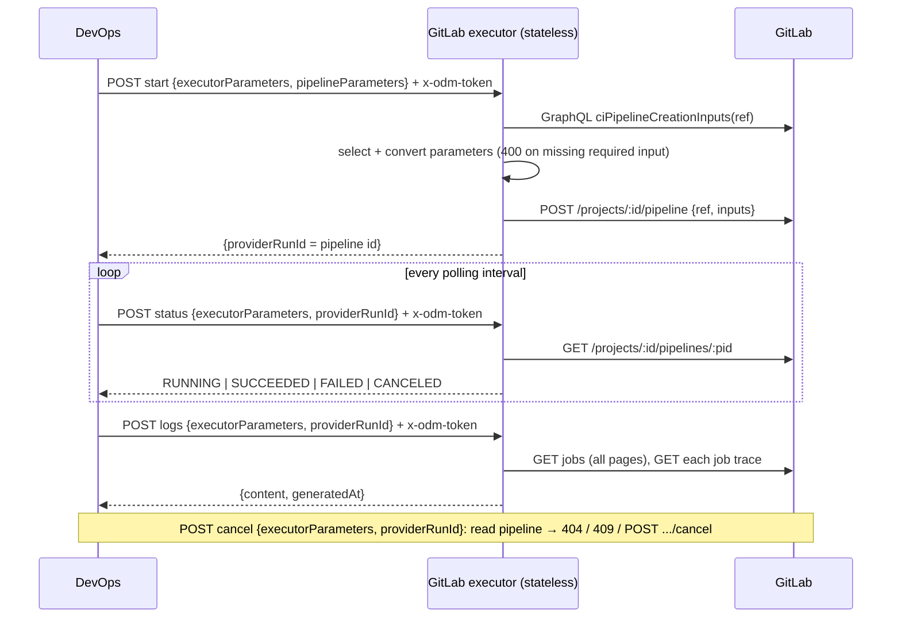

# SPDD Analysis: GitLab DevOps executor (full control)

Story **BDMD-5099**. Repository `odm-platform-adapter-devops-executor-gitlab`. It implements the executor API defined by the DevOps server (`odm-platform-pp-devops-server`, stories BDMD-5437 and BDMD-5440) for GitLab CI/CD. It also refactors that executor API, on both sides.

**Revision 3 (2026-10-14).** The second review closed the three remaining questions.

- **Undeclared pipeline parameters are dropped.** The executor writes their names, never their values, to its own log at start. They cannot go in the task's log block: the logs call does not receive the pipeline parameters, and a stateless executor cannot remember them from start.
- **The template leftovers go away.** This repo is re-instantiated from `blindata-backend-service-template-quarkus` **1.0.2**, which adds optional modules, with only the modules the executor needs (decision 12). Template 1.0.2 was published for this story on 2026-10-14: commit `c34b252` on `main`, tag `1.0.2`. Before publishing, the template's 38 script tests passed, and eight module selections (all modules, core only, each module alone, and the selection proposed for this executor) rendered and compiled.
- **The input-spec cache was researched online.** The GraphQL input query is cached by GitLab in the background. A first call can return `null` while the cache fills, and `failOnCacheMiss: true` turns that into an explicit error. Decision 4 and the technical risks now say how the executor handles it.

**Revision 2 (2026-10-14).** The review resolved every ambiguity of revision 1 and added requirements. What changed:

- **The executor is stateless.** It has no secret cache. Every design choice follows from that (see "Statelessness check").
- **New executor API shape.** Every executor call is a `POST` whose body carries `executorParameters`. Backward compatibility is not a constraint, because nothing has been deployed. This touches the DevOps server and the starter executor too.
- **Every GitLab `canceled` is `CANCELED`**, whoever canceled. The cancel-requested memory of revision 1 is removed.
- **Inputs only.** The executor reads the inputs that the GitLab CI configuration declares at the ref, and sends the matching pipeline parameters. A required input with no value is a 400. Values get a best-effort conversion to the declared type. The variables channel and the `parameters-mode` switch are removed.
- `pipelineIdentifier` is ignored silently and documented. GitLab picks the ref by its own rules. The target is the latest stable GitLab. The artifact and image name is `odm-platform-adapter-devops-executor-gitlab`. The secret type is `token`, and its header lifecycle is now described end to end.

Sources used:

- the DevOps server docs (`docs/`) and its SPDD analyses and prompts (`spdd/analysis/BDMD-5437-*`, `BDMD-5440-*`, `spdd/prompt/BDMD-5437-*`, `BDMD-5440-*`);
- the DevOps executor client and outbound ports, and its secret rewrite (`ExecuteActivitySecretsOutboundPortImpl`, `ExecutorSecretsStoreImpl`);
- the Blindata agent proxy (`ODMProxyService`) and the UI activity modal (`OdmAgentStartActivityModal.jsx`);
- the starter executor code in this repo;
- the official GitLab docs: the Pipelines API, Jobs API, CI/CD inputs, authentication, pipeline triggers, CI/CD variables, downstream pipelines, and the GraphQL reference. Read on 2026-10-13 and 2026-10-14.

## Original Business Requirement

BDMD-5099
I want to develop a complete gitlab executor (in the repository odm-platform-adapter-devops-executor-gitlab).
The executor should allow to support gitlab APIs.

Notes:
- Read the odm-platform-pp-devops-server documentation and spdd analyses/prompts
- Search online for gitlab documentation to implement the correct gitlab api.
- Suggest the right service configuration.

### Review outcome (2026-10-14), verbatim

Resolved Ambiguities:
- "Complete" and "support gitlab APIs". Confirmed
- No Acceptance cirteria are given. Confirmed the proposed ones.
- Pipeline parameter channel per task. The executor should select pipeline parameters matching the gitlab required inputs. If there is a mismatch, trhow a bad request error.
- Non-string inputs: best-effort typed conversion
- pipelineIdentifier on Gitlab: Ignore silently and document.
- Secret type name: OK for token. explain better in the analysis the header "lifecycle" e.g. how it is transformed form ui to the executor
- Ref semantics: let gitlab picks by its own rules.
- Which gitlab versions: support the last stable one
- Exceutor name and image distribution: Yes, use odm-platform-adapter-devops-executor-gitlab

Notes:
- Executor MUST be stateless services. All the architecture pivots around this. Do you spot any problem that invalidate this?
- Executor should not keep secret cache

Additional requirements:
- The devops executors interface should be refactored so all methods are POST and each method request body has at least the executorParameters inside. (note: do not take in account backward compatibility, because nothing has been deployed yet)
- For the canceled state, it is the same if done from Devops or from gitlab ui, so do not handle the difference.

### Review outcome, second round (2026-10-14), verbatim

1. drop them
2. should be drop. Delete them and re-instantiate the template by selecting only the required modules. (if the template patch version has not yet been published, do it)
3. search online

## Domain Concept Identification

### Existing Concepts (from codebase)

- **Executor API** (DevOps server `client.executor`; starter `ExecutorTaskController`; starter repo `odm-platform-adapter-devops-executor-starter`): the four calls DevOps makes to a full-control executor: start, status, logs, cancel. They live under `/api/v2/up/executor/tasks/`. Today, start and cancel are `POST`, and status and logs are `GET` with a `providerRunId` query parameter. Only start sends `executorParameters`. This story changes the shape (decision 1).
- **DevOps callers of the executor API**: Execute Task (start, status poll, logs) and Cancel Activity (cancel, which treats any 4xx as "already finished"). Both hold the `Task` entity, which stores the executor parameters as received. Every call can therefore send them without a new data source.
- **Executor parameters**: where the pipeline is.
  - Repository coordinates: `providerType`, `providerBaseUrl`, `externalIdentifier`, `name`, `remoteUrlHttp`, `defaultBranch`, and so on.
  - The git ref: `name` and `type`.
  - An optional `repositoryKey`, and a provider-neutral `pipelineIdentifier`.
  - DevOps never reads their content. GitLab reads `providerBaseUrl` (the instance root), `externalIdentifier` (the numeric project id) and `ref.name`.
- **Pipeline parameters**: free key-value strings from the data product team. DevOps resolves them before start. They are not secret.
- **Provider run id**: an opaque string of at most 255 characters, stored by DevOps and returned on every later call.
- **Executor secrets**: the caller's credentials. DevOps holds them in memory per executor and activity, and attaches them to every executor call as `x-odm-<secretType>`. They are never stored, logged, returned or put in events.
- **Common status vocabulary**: `RUNNING`, `SUCCEEDED`, `FAILED`, `CANCELED`. A run that is not terminal is `RUNNING`, including a run waiting for a person. There is no `CANCELING`.
- **Executor declaration and polling** (DevOps configuration):
  - An executor is a name, `execution-mode: full-control` and an `address`.
  - Polling uses a fixed interval (default 30 s). The number of polls is the secrets TTL divided by that interval.
  - The secrets TTL therefore caps how long a pipeline may run.
- **Starter executor** (this repo today): a copy of `odm-platform-adapter-devops-executor-starter`.
  - Quarkus 3 on Java 21, no database.
  - Layering: `rest` (`ExecutorTaskController`), `services` (`SimulatedRunStore`), `resources`, `exceptions` with an `ExceptionMapper`, and a `java.net.http` client toolkit (`utils.client.*`).
  - SPDD norms in `spdd/norms/`.
  - The starter's identity is still in place: its `artifactId`, README, Dockerfile, `template.yaml` and simulation settings.
  - It was instantiated from template 1.0.1, which had no modules. Its `template.yaml` therefore records no module selection, and the repo has no `template-v1.0.1` tag. The pom carries every template dependency, including persistence (Hibernate ORM, PostgreSQL JDBC, Narayana JTA, the JPA metamodel generator), which the executor never uses.
  - Local, uncommitted change: `ExecutorTaskResource` renamed to `ExecutorTaskController`, with its test.
- **Backend service template** (`blindata-backend-service-template-quarkus`, now **1.0.2**): renders a core (shared exceptions, `Page`/`Sort`, `VersionedRes`, `AsyncExecutorService`, `quarkus-arc`, `jakarta.ws.rs-api`) plus the selected optional modules: `persistence`, `usecases`, `usecases-transactional`, `http-service`, `rest-client`. `scripts/template-sync apply|update --modules ...` renders a selection and records it in the target `template.yaml`.
- **Secret-carrying parties**:
  - The Blindata UI: it lets the user choose a personal secret per executor and secret type.
  - The Blindata agent proxy (`ODMProxyService`): it resolves the chosen secret and checks that every secret type declared for each executor is present.
  - The DevOps server: it filters, renames and caches the secret headers.
- **Registry repository record** (`DataProductRepoRes`): the source of the repository coordinates. For GitLab, `providerBaseUrl` is the instance root. The `git-utils` GitLab provider adds `/api/v4/...` to it.

### New Concepts Required

- **GitLab project**: the owner of one CI/CD configuration. It is identified by `externalIdentifier` on the instance at `providerBaseUrl`.
- **GitLab pipeline**: one run of that configuration at a ref. A DevOps task maps to one pipeline. The provider run id is the pipeline id.
- **GitLab job**: a unit of a pipeline, and the unit of GitLab logs. The executor aggregates job logs into one block.
- **Declared pipeline inputs (input spec)**: the inputs that the project's CI configuration declares at a ref (`spec:inputs`). Each has a name, a type (`string`, `number`, `boolean`, `array`), whether it is required, a default, options and a regex. The executor reads them before every start, through the GitLab GraphQL field `Project.ciPipelineCreationInputs(ref)`.
- **Parameter selection**: the rule that turns pipeline parameters into GitLab inputs against the input spec (decision 4).
- **GitLab access token**: the credential in the `x-odm-token` header. It is used for one GitLab call sequence and dropped when the request ends.
- **Allowed GitLab instances**: executor configuration that lists the hosts a token may be sent to.
- **Aggregated log block**: all job logs of a pipeline, in execution order, under a size bound.

### Key Business Rules

Explicit:

- **The executor is stateless.** It keeps no run, no secret and no token between requests. Everything it needs comes in the request (body and headers) or from GitLab. Configuration is not state.
- The executor knows nothing about activities, versions or policies.
- **Every executor call is a `POST` whose body carries `executorParameters`.** Start adds `pipelineParameters`. Status, logs and cancel add `providerRunId`.
- Credentials are never logged, returned or put in events. Only header names may be logged.
- **Pipeline parameters reach GitLab only as inputs.**
  - Only the parameters whose names match a declared input are sent.
  - A required input with no matching parameter, and no default, is a 400 that names the missing inputs. No pipeline is created.
- Parameter values get a best-effort conversion to the declared input type. GitLab's own validation decides in the end.
- `pipelineIdentifier` is ignored, silently. The README documents this.
- `ref.name` is sent as given. GitLab resolves it by its own rules. `ref.type` is not used.
- **Any GitLab `canceled` pipeline is `CANCELED`,** whether DevOps canceled it or a person did it in the GitLab UI.
- Cancel of an unknown run is 404. Cancel of a run that has already ended is 409. A cancel of a run that is already canceling is a success.
- Logs are read once, after the run ends, as one block with `generatedAt`.

Implicit:

- **GitLab answers 200 to a cancel in every state.** The executor must read the pipeline first to produce 404 and 409.
- **GitLab rejects unknown inputs** and inputs with invalid values, and allows at most 20 inputs. Selecting only declared inputs avoids the "unknown input" rejection by construction.
- **The token goes to a host taken from request data.** Every call checks `providerBaseUrl` against the allowed instances, not only start.
- **Cancel now reports `CANCELED` for UI cancels**, which changes a rule written in the DevOps docs: "stopped directly in the tool" was `FAILED`. The DevOps docs must follow. An activity whose pipeline someone cancels in GitLab ends `CANCELED` and emits `ACTIVITY_CANCELED`, without a cancel request in DevOps.
- **DevOps reads any 4xx on cancel as "already finished".** A malformed cancel body (for example, missing `executorParameters`) would also be read that way. DevOps must always send the full body.

## Strategic Approach

### Solution Direction

- **Refactor the executor API first, on both sides**, then build GitLab behind the new shape:
  - DevOps server: the executor client and its resources, its two callers (Execute Task, Cancel Activity), its mocks and tests, and its docs.
  - Starter executor repo: endpoints, tests and README, so it stays the reference implementation.
  - This repo: the copied starter endpoints become the GitLab executor's endpoints.
- **Replace the simulated run store with a stateless GitLab gateway** that calls GitLab REST API v4, plus one GraphQL query for the input spec. The flow per call is below. Every call validates `executorParameters`, checks the instance against the allow-list, and reads the token from `x-odm-token`.
  - **start**: read the declared inputs at the ref, select and convert the pipeline parameters, create the pipeline on the ref with those inputs, and return the pipeline id as `providerRunId`.
  - **status**: read the pipeline in the project, and map its status.
  - **logs**: list the pipeline's jobs, read each job log, and aggregate them.
  - **cancel**: read the pipeline. Return 404 if it is unknown and 409 if it has ended. Otherwise cancel it in GitLab.
- **Reuse** the repo's layering and norms, its exception hierarchy and mapper, the `RestUtils` toolkit, the "header names only" logging rule, and `ConfigMapping` configuration (replacing `executor.simulation`).
- **Re-instantiate the project from template 1.0.2, with only the modules it needs** (decision 12), under the identity `odm-platform-adapter-devops-executor-gitlab`. This removes the persistence and transactional leftovers and the simulation code. The service files (executor endpoints, resources, exception mapper, configuration, README, Dockerfile, CI workflow, SPDD folders) are then rebuilt on top of the render.
- **Document**: the GitLab executor README (configuration, token, inputs, statuses, supported GitLab version, `pipelineIdentifier` ignored), the DevOps docs (executor contract shape, cancel rule), and the starter README.



### Statelessness check: does anything invalidate it?

No. Nothing in DevOps, GitLab or the requirement needs executor state. One capability was given up for it, and it is accepted.

| Concern | Without state, how | Verdict |
|---|---|---|
| Finding the run again | The new API sends `executorParameters` on every call, so the project and instance come from the body. The provider run id is just the pipeline id. Revision 1's encoded run id is no longer needed. | Solved by the API refactor |
| Credentials | DevOps attaches `x-odm-token` to every call, from its own cache (DevOps already owns that cache and its TTL). The executor reads the token per request and keeps no copy: no cache, no pooled client tied to a token. | Holds |
| "Canceled by DevOps" vs "canceled in GitLab" | Needed memory in revision 1. Removed by the review: every `canceled` is `CANCELED`. | Dropped by decision |
| 404/409 on cancel | A read of the pipeline before the cancel, in the same request. | Holds |
| Input spec | Read from GitLab at every start (one GraphQL call). Not cached by the executor. | Holds, costs one call per start |
| Start idempotency | A stateless executor cannot recognise a repeated start, so a retried start creates a second pipeline. DevOps does not retry start, and the executor must not retry its own pipeline creation. | Accepted residual risk, not a blocker |
| Input spec computed asynchronously by GitLab | GitLab caches the result in the background ("reactive cache", MR !218758). On a cold cache the first call returns `null` and queues a worker. With `failOnCacheMiss: true`, the miss becomes the GraphQL error "Failed to retrieve pipeline inputs from cache", so it cannot be mistaken for "no inputs declared". The executor retries within the same request, for a bounded time, until the cache is warm. GitLab holds the cache, not the executor. | Holds, with a bounded in-request retry (decision 4) |
| Dropped parameter names in the task logs | The logs call does not receive the pipeline parameters, and nothing remembers them from start. The names go to the executor's own log at start instead. DevOps already stores and shows every pipeline parameter. | Accepted |
| Scaling and restarts | No state, so any number of replicas, and restarts lose nothing. The DevOps limitation "restart during a run" stays on the DevOps side only. | Improves on revision 1 |

### Key Design Decisions

1. **New executor API: every call is `POST` with `executorParameters` in the body.**

   | Call | Path | Body | Response |
   |---|---|---|---|
   | start | `POST /api/v2/up/executor/tasks/start` | `executorParameters`, `pipelineParameters` | `providerRunId` |
   | status | `POST /api/v2/up/executor/tasks/status` | `executorParameters`, `providerRunId` | `providerRunId`, `status` |
   | logs | `POST /api/v2/up/executor/tasks/logs` | `executorParameters`, `providerRunId` | `content`, `generatedAt` |
   | cancel | `POST /api/v2/up/executor/tasks/cancel` | `executorParameters`, `providerRunId` | empty 200 |

   - A missing `executorParameters` is a 400 on every call. A missing `providerRunId` on status, logs or cancel is a 400. The secret headers do not change.
   - Paths stay the same. There is no compatibility shim, because nothing is deployed.
   - The exact field layout (one shared request shape or one per call) is for the canvas.
   - Why: the executor needs the pipeline location on every call to stay stateless. This supersedes BDMD-5437 decision I-17 ("status and logs send only `providerRunId`"). That decision must be marked superseded in the DevOps server's SPDD artefacts (follow-up via `/spdd-sync` or `/spdd-prompt-update` there).
   - Scope across repos:
     - DevOps server: executor client interface and implementation, request resources, the Execute Task and Cancel Activity executor ports (both already have the `Task` and its stored executor parameters), the test mocks (`ScriptedExecutor`, `ExecutorClientFactoryMock`), `ExecutorClientImplTest`, and the docs.
     - Starter executor repo: controller, request resources, tests and README.
     - This repo: the same endpoints, backed by GitLab.

2. **How a run is started: the Pipelines API with one access token.** A trigger token can only create pipelines. It cannot be shown to read status, read logs or cancel. An access token with the `api` scope does all of it, and covers the GraphQL read. The token's owner needs a role allowed to run pipelines (Developer or above).

3. **Provider run id = the GitLab pipeline id**, as a string. The project and instance come from `executorParameters`. A pipeline id that does not exist in that project is a 404 from GitLab, and the executor reports it as 404.

4. **Pipeline parameters → inputs, selected against the declared input spec.**
   - Before creating the pipeline, read the declared inputs at the ref through GraphQL `Project.ciPipelineCreationInputs(ref, failOnCacheMiss: true)`. It returns name, type, required, default, options and regex per input (`CiInputsSpec`). The field exists since GitLab 17.10, with status Experiment.
   - Cache handling. GitLab computes the result in the background and caches it (MR !218758, feature flag `ci_pipeline_inputs_reactive_cache`; with the flag off, the result is computed directly).
     - With `failOnCacheMiss: true`, a cold cache returns the GraphQL error "Failed to retrieve pipeline inputs from cache" instead of `null`.
     - The executor retries that call within the same start request: short fixed waits, under a configured total budget (proposal: 1 s apart, at most 20 s).
     - If the cache is still cold when the budget runs out, the start fails with **503** and a message saying the input spec is not ready yet. No pipeline is created, because sending inputs blind could fail on unknown inputs or skip required ones.
     - An empty list (no `spec:inputs`) is not a miss: the pipeline is created with no inputs.
     - The cache key and lifetime are not documented. GitLab resets the cache when the inputs change in the CI file.
   - Selection:
     - each declared input whose name matches a pipeline parameter is sent, with that value;
     - a declared input that is required, has no default, and has no matching parameter makes the start fail with **400**, naming every missing input;
     - a declared input with a default and no parameter is not sent, so GitLab applies the default;
     - a pipeline parameter that matches no declared input is dropped. Its name, never its value, goes to the executor's log at start (decided in review round 2).
   - Best-effort typed conversion of a string value, according to the declared type:
     - `number`: parse as a number;
     - `boolean`: `true` or `false`, case-insensitive;
     - `array`: parse as a JSON array;
     - `string`: unchanged.
     - If parsing fails, the raw string is sent and GitLab's validation decides. GitLab's 400 (type, `options` or `regex` mismatch) is returned as a 400 with GitLab's message.
   - No variables channel, no `parameters-mode`. A CI configuration that declares no inputs receives none.
   - The 20-input limit cannot be exceeded by the selection, because GitLab caps what can be declared.

5. **Status mapping.**

   | GitLab pipeline status | Executor status |
   |---|---|
   | `created`, `waiting_for_resource`, `preparing`, `waiting_for_callback`, `pending`, `running`, `scheduled`, `canceling`, `manual` | `RUNNING` |
   | `success` | `SUCCEEDED` |
   | `failed`, `skipped` | `FAILED` |
   | `canceled` | `CANCELED` (from DevOps, from the GitLab UI, or from GitLab auto-cancel) |
   | any value not listed | `RUNNING`, so the DevOps poll cap bounds the wait |

   - `manual` stays `RUNNING`, per the DevOps rule "waiting for a person is running". If nobody acts, the poll cap fails the task.
   - The cancel rule changes the DevOps docs (*How tool statuses are reported* in `how-devops-works.md`) and BDMD-5440 DD-41. Both must be updated in the same story.

6. **Cancel on top of a GitLab that always answers 200.**
   - The executor reads the pipeline first.
     - Not found: 404.
     - `success`, `failed`, `skipped` or `canceled`: 409. GitLab is not called.
     - `canceling`: 200. GitLab is not called.
     - Otherwise: `POST .../cancel`, then 200.
   - The window between the read and the cancel is accepted: the next status read returns the real end state.

7. **Logs: one block built from job logs.**
   - List all jobs of the pipeline, following every page (GitLab returns 20 per page, newest first). Order them oldest first.
   - Each job gets a header with its name, stage and status, followed by its log.
   - A job with no log (GitLab 404 "no log file") gets a note, not an error.
   - The total size is bounded. Truncation is marked in the text.
   - Child and downstream pipelines are not followed.

8. **Credentials: secret type `token`, read per request, never cached.** The full header lifecycle:

   | Hop | Header as it travels | Who transforms it, and how |
   |---|---|---|
   | 1. UI → Blindata agent | `x-odm-ag-<executorName>-executor-secret-token: <personal secret name>` | The UI (`OdmAgentStartActivityModal`) lets the user pick one personal secret per executor and per secret type declared in the agent's DevOps configuration (`devops.executors.<executorName>.secrets[].secretType = token`). It sends the secret's **name**, never its value. |
   | 2. Blindata agent → DevOps `POST /activities/execute` | `x-odm-<executorName>-executor-secret-token: <token value>` | The agent proxy (`ODMProxyService`) checks that every declared secret type of every executor is present (400 otherwise). It looks up the personal secret by name and type (stored encrypted, decrypted on read), removes the `x-odm-ag-` header, and adds the same header without `ag-`, holding the value. An instrumented pipeline or a direct API client sends this header to DevOps directly. |
   | 3. Inside DevOps | cache entry `x-odm-token: <value>` under key `<executorName>-ID-<activityUuid>` | For each executor used by the activity's tasks, Execute Activity keeps only the headers with the prefix `x-odm-<executorName>-executor-secret-` (case-insensitive), renames them to `x-odm-<secretType>` (lowercased), and stores them in the in-memory Caffeine cache for `secrets-ttl`. Nothing is persisted. The entries are removed when the activity ends. |
   | 4. DevOps → GitLab executor (start, status, logs, cancel) | `x-odm-token: <value>` | The executor client looks up the cache for this executor and activity, and attaches the headers to every call. Only the executor named in the task receives them. Once the TTL has expired, calls go out without the header. |
   | 5. GitLab executor → GitLab | `PRIVATE-TOKEN: <value>` | The executor reads `x-odm-token` from the request, uses it for the GitLab calls of that request only, and drops it. There is no cache. A missing or blank header is a 400 that names `x-odm-token`. The value is never logged, echoed in errors or returned. |

   - The executor name (`gitlab` in the examples) is administrator-chosen. It must be the same in four places: the DevOps executor declaration, the agent's DevOps executor configuration, the descriptor tasks, and the header name.

9. **Which GitLab instance: request data checked against configuration, on every call.**
   - `providerBaseUrl` must match an allowed instance, after normalisation.
   - A blank `providerBaseUrl` falls back to the configured default instance. Anything else is refused: 400 at start, and the same refusal on later calls.
   - TLS verification stays on. Redirects to another host are not followed.

10. **HTTP client: the repo's `RestUtils` toolkit, extended where needed.**
    - It already maps errors to `ClientException` (status code and body) and is native-image friendly.
    - Needed:
      - reading plain-text job logs (it parses JSON only);
      - a GraphQL `POST`;
      - bounded timeouts;
      - retries on reads only, never on pipeline creation.
    - The Quarkus REST client is the alternative. The canvas decides.

11. **GitLab version: the latest stable release.**
    - On 2026-10-14 that is the **19.4** line (GitLab releases monthly; 19.5 is due on 2026-10-15).
    - The README states the version tested against. It also states the minimum the design needs: pipeline inputs on the Pipelines API are generally available from 18.1, and the GraphQL input spec exists from 17.10.
    - Older versions are not supported.

12. **Re-instantiate this repo from template 1.0.2, with only the required modules.**

    | Module | Selected | Why |
    |---|---|---|
    | core | always | Shared exceptions (`BadRequestException`, `NotFoundException`, `ResourceConflictException`, `InternalException`), `quarkus-arc`, `jakarta.ws.rs-api`. |
    | `http-service` | **yes** | The four inbound JAX-RS endpoints. `CorrelationIdFilter`, `quarkus-rest`. |
    | `rest-client` | **yes** | `RestUtils` and `ClientException` for the GitLab REST and GraphQL calls (decision 10). `quarkus-jackson`. It also brings `java-jwt` for `AuthenticatedRestUtilsTemplate`, which the executor does not use. That cost is accepted to stay on the template's module boundary. |
    | `usecases` | **yes** | Start (input spec, then selection, then create) and cancel (read, then decide, then cancel) are multi-step workflows. Under `spdd/norms/USE_CASE_IMPLEMENTATION.md` they are use cases with outbound ports. No dependencies. |
    | `persistence` | no | The executor is stateless and has no database. |
    | `usecases-transactional` | no | It requires `persistence`. Nothing is transactional. |

    - Template parameters for the render:
      - `artifactId: odm-platform-adapter-devops-executor-gitlab`
      - `serviceName: executor-gitlab`
      - `description: DevOps executor for GitLab CI/CD pipelines`
      - `groupId: org.opendatamesh`
      - `basePackage`: proposed `org.opendatamesh.platform.up.executor.gitlab`. The executor API is under `/api/v2/up/...`, and "up" is the utility plane. Keeping the starter's `org.executor` is the alternative.
      - `serviceClassPrefix` is derived as `ExecutorGitlab`.
    - The service adds what the template leaves to the adopter:
      - `quarkus-rest-jackson` (JSON on the JAX-RS endpoints);
      - `quarkus-config-yaml`;
      - the test stack (`quarkus-junit`, `rest-assured`, and a stub for GitLab);
      - the `native` packaging it already uses;
      - its `application.yaml` without any datasource or ORM keys. Persistence is no longer present, so `quarkus.datasource.active: false` and `quarkus.hibernate-orm.active: false` are no longer needed.
    - How:
      - The repo has a single starter commit and no `template-v1.0.1` tag, so `update` cannot find a base. Use `scripts/template-sync apply` with `--modules http-service,rest-client,usecases` and the parameters above. It creates the orphan branch `update/template-v1.0.2` and the tag `template-v1.0.2`.
      - Then replace the old tree with the render on the integration branch, and rebuild the service code on it.
      - Merging, and the treatment of the uncommitted `ExecutorTaskController` rename, follow the template's merge rule: the agent asks before any merge. The rename is superseded, because the controller is rewritten for the new API.

### Alternatives Considered

- **Encoding instance and project in the provider run id** (revision 1). Superseded: the new API carries `executorParameters` on every call.
- **An in-memory map of runs, or a cancel-requested memory** (revision 1). Rejected: it conflicts with statelessness, and the review removed the need.
- **A token cache in the executor.** Rejected: DevOps already caches secrets per activity and sends them on every call. A second cache would widen exposure for no benefit.
- **The variables channel or a `parameters-mode` switch.** Rejected by the review. Variables are also blocked by default on new GitLab.com projects.
- **Sending all parameters as inputs and letting GitLab reject the extra ones.** Rejected: GitLab refuses unknown inputs, so any extra parameter would fail the start. The review asked for selection against the declared inputs.
- **Reading `.gitlab-ci.yml` through the repository files API and parsing `spec:inputs`.** Rejected: it misses `ci_config_path`, includes and external input files. The GraphQL field resolves all of them on the GitLab side.
- **Trigger tokens.** Rejected: they only create pipelines.
- **Removing the leftovers by hand from the current tree.** Rejected by the review. A hand-pruned tree would not match any template render. Later `template-sync update` runs would bring the files back, or conflict, because `template.yaml` would record no module selection.
- **Calling the input-spec query without `failOnCacheMiss`.** Rejected: on a cold cache it returns `null`, which looks like "no inputs declared". Required inputs would then go unchecked, and declared inputs would be dropped.
- **Following child and downstream pipelines.** Deferred: not needed for a complete executor of this contract.

### Suggested service configuration

**DevOps server side** (`odm-platform-pp-devops-server`):

```yaml
odm:
  utility-plane:
    executors:
      polling-interval: 30s        # pipelines take minutes; keeps GitLab load low
      secrets-ttl: 4h              # must exceed your longest pipeline: polls stop after ttl/interval
                                   # and the token is no longer sent after the ttl (default 1h is short for most CI)
      services:
        gitlab:
          address: http://odm-platform-adapter-devops-executor-gitlab:9080
          execution-mode: full-control
```

**Blindata agent side** (the DevOps proxy configuration of the job): declare the executor `gitlab` with one secret of type `token`. The UI then asks for it, and the agent refuses an execute request without it.

**GitLab executor side** (`src/main/resources/application.yaml`, replacing `executor.simulation`):

```yaml
quarkus:
  http:
    port: 9080

executor:
  gitlab:
    default-base-url: https://gitlab.com          # used when providerBaseUrl is blank
    allowed-base-urls:                            # the only hosts a token may be sent to
      - https://gitlab.com
    http:
      connect-timeout: 5s
      read-timeout: 30s
      read-retries: 2                             # status, logs, input spec, cancel pre-read; never pipeline creation
    input-spec:
      cache-miss-retry-interval: 1s               # GitLab reactive cache warming (decision 4)
      cache-miss-budget: 20s                      # then 503, no pipeline
    logs:
      max-job-log-size: 1MB
      max-total-size: 5MB
```

- `allowed-base-urls` and `default-base-url` are the only settings to change for a self-managed GitLab. Start-up fails on an empty or malformed list.
- The executor is stateless. Run as many replicas as needed behind one address.
- Token to document for users: a project, group or personal access token with the `api` scope, owned by a user or bot with at least the Developer role. The CI configuration must declare in `spec:inputs` every parameter the pipeline expects.
- Property names are proposals. The canvas fixes them.

## Risk & Gap Analysis

### Requirement Ambiguities

All ambiguities are resolved (review rounds 1 and 2). One naming choice is left to the canvas: `basePackage` (`org.opendatamesh.platform.up.executor.gitlab` proposed, decision 12).

### Edge Cases

- **Input-spec cache cold at start:** retried within the request. If it is still cold at the end of the budget: 503, no pipeline. DevOps fails the task and the user executes again; by then the cache is warm.
- **A typo in a parameter name:** the parameter is dropped. If the input it was meant for has a default, the pipeline runs with the default, and only the executor's log shows the dropped name.
- **Start rejected by GitLab** (ref not found, CI errors, no job created, a `workflow:rules` block, input type, options or regex mismatch): 400 with GitLab's message, and no run id.
- **A required input missing:** 400 from the executor, before any pipeline is created, naming the inputs.
- **The ref has no CI configuration, or it declares no inputs:** the input spec is empty, so no inputs are sent. GitLab then accepts or rejects the pipeline by its own rules.
- **A parameter declared as `array` with a non-JSON value:** sent as a string, and GitLab rejects it with a 400.
- **Start succeeds on GitLab but the response is lost:** DevOps fails the task, and an orphan pipeline runs in GitLab. There is no retry, because a retry would duplicate it.
- **A pipeline stays `pending`, `manual` or `waiting_for_resource`:** it is `RUNNING` until the DevOps poll cap fails the task. The pipeline in GitLab keeps going.
- **A pipeline canceled in the GitLab UI or by auto-cancel:** the task becomes `CANCELED`, and the activity ends `CANCELED` with `ACTIVITY_CANCELED`, even though nobody canceled it in DevOps.
- **A pipeline that outlives the secrets TTL:** status calls arrive without `x-odm-token` and get a 400, and the task fails. Mitigation: the `secrets-ttl` advice above.
- **A token without the `api` scope or the needed role:** 401 or 403 from GitLab, returned as a clear error. The token is never echoed.
- **A pipeline deleted or a project moved during the run:** a 404 on status. That is an error to DevOps, not `FAILED`.
- **GitLab returns 429 or 5xx during the poll:** a bounded retry on reads. Otherwise a server error to DevOps, never a run status.
- **A body whose `providerBaseUrl` or `externalIdentifier` differs from the one used at start:** not possible from DevOps, which sends the stored values. Otherwise GitLab answers 404, or the allow-list refuses the host.
- **Very many jobs or very large logs:** pagination is followed to the end, and the size bounds apply.
- **Child or downstream pipelines:** a parent can succeed while a child fails, with the default trigger strategy. This is documented.

### Technical Risks

- **The GraphQL input-spec field is an Experiment** (`Project.ciPipelineCreationInputs`, introduced in GitLab 17.10). It may change or be removed.
  - The reactive cache and `failOnCacheMiss` come from MR !218758 (opened 2026-01, issue #581342 tagged 18.10). The live GraphQL reference lists `failOnCacheMiss` on this field, so it is in the current schema.
  - Not documented: the cache key, the lifetime, the time a cold cache takes to warm, and the flag's default.
  - Mitigation: `failOnCacheMiss: true`, and a bounded in-request retry ending in 503 (decision 4).
  - Mitigation: the read sits behind one gateway method, so it can be swapped if GitLab adds a REST endpoint.
  - Mitigation: a smoke test on GitLab.com covers both the cold and the warm path.
- **Cross-repo change set.** The API refactor touches three repositories (DevOps server, starter, GitLab executor), and they must ship together. DevOps reads every 4xx on cancel as "already finished", so a body mismatch would hide failures silently.
  - Mitigation: one shared request shape.
  - Mitigation: contract tests in DevOps (`ExecutorClientImplTest`) and in each executor.
  - Mitigation: the DevOps SPDD artefacts updated for I-17 and DD-41.
- **Token exfiltration through `providerBaseUrl`.** Mitigation: the allow-list on every call, TLS on, no cross-host redirects.
- **Log leakage.** GitLab masks only masked variables, and says masking is not a guarantee. The executor adds no secret to the log block. The README warns that logs are only as safe as the pipeline's own output.
- **Client toolkit gaps** (plain text, GraphQL, timeouts, read-only retries). They are settled in the canvas and tested against a stubbed GitLab.
- **GitLab API drift** (new statuses, input features). Unknown statuses map to `RUNNING`, and the mapping and the conversions live in one place each. GitLab rate limits were not read in this analysis (the page moved). Read them before sizing the polling and log reads. A second attempt to read the rate-limit pages during revision 3 was blocked by the session's permission settings.
- **Native image.** New JSON mappings, including the GraphQL response, need reflection registration. A native build is part of the verification.
- **Test strategy.** There is no GitLab in CI.
  - A stubbed GitLab (for example WireMock) scripts the documented REST and GraphQL responses.
  - An optional manual smoke test runs against GitLab.com 19.4 with a throwaway project.

### Acceptance Criteria Coverage

The ACs proposed in revision 1 were confirmed. AC 11 to AC 14 come from the review.

| AC# | Description | Addressable? | Gaps/Notes |
|-----|-------------|--------------|------------|
| 1 | A complete GitLab executor exists in `odm-platform-adapter-devops-executor-gitlab` and implements the executor API (start, status, logs, cancel) | Yes | Simulated store replaced by a stateless GitLab gateway. |
| 2 | Start creates a GitLab pipeline on the given project and ref, passes the pipeline parameters, and returns a provider run id | Yes | Inputs only. The provider run id is the pipeline id. |
| 3 | Status maps GitLab statuses to `RUNNING`, `SUCCEEDED`, `FAILED`, `CANCELED` | Yes | Decision 5. Every `canceled` is `CANCELED`. |
| 4 | Logs return one aggregated block with `generatedAt` | Yes | Decision 7. Child pipelines are not followed. |
| 5 | Cancel stops a running pipeline, 404 for an unknown run, 409 for an ended run | Yes | Decision 6 (read before cancel). |
| 6 | Credentials arrive only as `x-odm-token`, are used as the GitLab token, and are never logged, returned or cached | Yes | Decision 8 (full header lifecycle). |
| 7 | The implementation uses the correct GitLab APIs, from the GitLab documentation | Partial | REST Pipelines and Jobs APIs and the GraphQL input spec are identified. The cache-miss behaviour of the input query is now researched (reactive cache, `failOnCacheMiss`). Still not read: GitLab's rate limits. Still not settled: the time a cold cache needs to warm. Both are checked in the smoke test. |
| 8 | A suggested service configuration is provided | Yes | DevOps, agent and executor configuration above. |
| 9 | Behaviour is consistent with the DevOps documentation and SPDD artefacts | Yes | Two rules change by decision: I-17 (status and logs send only the run id) and the cancel rule of DD-41 and the docs. Both are updated in the same story. |
| 10 | The repository documents how to run, configure and use the executor | Yes | README rewritten. It covers `pipelineIdentifier` (ignored), inputs, the token, the version, and the statuses. |
| 11 | The executor is stateless and keeps no secret cache | Yes | See "Statelessness check": no blocker. The residual risks are start idempotency and the input-spec cache miss. |
| 12 | Every executor API call is `POST` and carries `executorParameters`, in DevOps, the starter and the GitLab executor | Yes | Decision 1. Three repositories. |
| 13 | Pipeline parameters are selected against the declared GitLab inputs; a mismatch is a 400; values get a best-effort type conversion | Yes | Decision 4. Undeclared parameters are dropped, and their names go to the executor's log. |
| 14 | The executor targets the latest stable GitLab | Yes | 19.4 on 2026-10-14. The README states the tested version. |
| 15 | The repo is re-instantiated from the template with only the required modules, and the template's patch version is published | Yes | Template 1.0.2 is published (`c34b252`, tag `1.0.2`). The render uses `http-service`, `rest-client` and `usecases` (decision 12). |

## Open questions to settle before `/spdd-reasons-canvas`

None blocking. The canvas fixes:

- the `basePackage` (proposal in decision 12);
- the input-spec retry budget (proposal: 1 s apart, 20 s at most);
- the property names.

The smoke test on GitLab 19.4 covers the cold input-spec cache and the rate limits.
