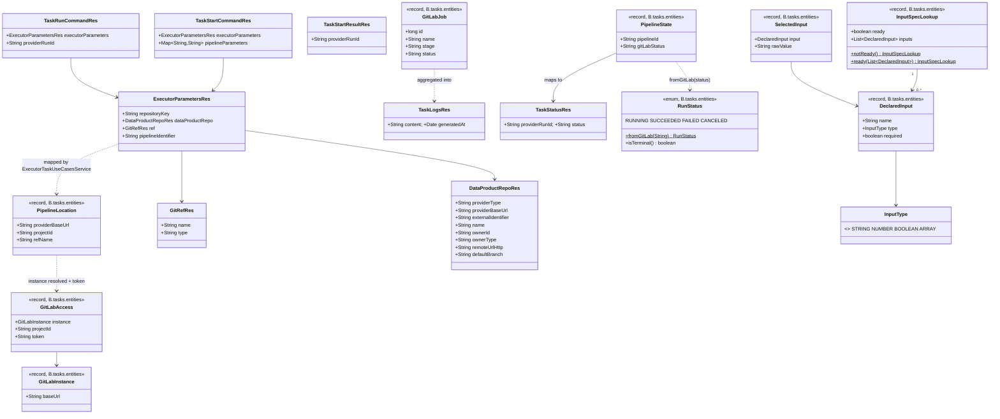

# GitLab DevOps executor (stateless, full control) and POST-only executor API

Story **BDMD-5099**. Source analysis: `spdd/analysis/BDMD-5099-202610131530-[Analysis]-gitlab-devops-executor.md` (revision 3).

The canvas spans three repositories. They ship together:

| Repo | Short name | Role in this story |
|---|---|---|
| `odm-platform-adapter-devops-executor-gitlab` | **GX** | Re-instantiated from the template, then implemented as the GitLab executor |
| `odm-platform-pp-devops-server` | **DS** | Executor client and its callers move to the POST-only API |
| `odm-platform-adapter-devops-executor-starter` | **ST** | Reference executor moves to the POST-only API |

GX base package after re-instantiation: `org.opendatamesh.platform.up.executor.gitlab`, written **`B`** below. Its API exception base class is `ExecutorGitlabApiException`, which the template derives from `serviceName: executor-gitlab`.

## Requirements

1. Implement a **stateless** GitLab executor that runs a DevOps task as one GitLab CI/CD pipeline. Through the executor API it can:
   - start the pipeline on the task's project and ref;
   - report the pipeline's status in the common vocabulary;
   - return its job logs as one block;
   - cancel it.

   It keeps no run, no secret and no token between requests.
2. Refactor the executor API so that every call is `POST` with `executorParameters` in the body. Do it in the DevOps server, the starter executor and the GitLab executor. Backward compatibility is not required.
3. Pass pipeline parameters to GitLab only as **pipeline inputs**, selected against the inputs that the CI configuration declares at the ref:
   - a required input with no value is a 400;
   - undeclared parameters are dropped;
   - values get a best-effort conversion to the declared type.
4. Send the caller's GitLab token only to allowed GitLab instances, and never log, return or keep it.
5. Re-instantiate GX from `blindata-backend-service-template-quarkus` **1.0.2** with only the modules it needs (`http-service`, `rest-client`, `usecases`). Re-identify it as `odm-platform-adapter-devops-executor-gitlab`.
6. Document the executor's configuration, token, inputs, status mapping, supported GitLab version (19.4, the latest stable), and the fact that `pipelineIdentifier` is ignored. Update the DevOps and starter docs for the new API shape and the cancel rule.

Out of scope:

- child and downstream pipelines;
- CI/CD variables;
- trigger tokens;
- GitLab versions older than 18.1;
- retrying pipeline creation;
- any executor-side cache.

## Entities



- **API resources (GX and ST).** `ExecutorParametersRes`, `DataProductRepoRes` and `GitRefRes` keep their current fields. `TaskStartCommandRes` and `TaskStartResultRes` do not change. `TaskStatusRes` and `TaskLogsRes` do not change.
  - New: `TaskRunCommandRes`, the one shared body for status, logs and cancel.
  - Removed: `TaskCancelCommandRes`, replaced by `TaskRunCommandRes`.
  - All request resources keep `@JsonIgnoreProperties(ignoreUnknown = true)`.
- **DS client resources.** One request class per client call, each `{ ExecutorParametersRes executorParameters; String providerRunId; }`: `ExecutorTaskStatusCommandRes` (new), `ExecutorTaskLogsCommandRes` (new), and `ExecutorTaskCancelCommandRes` (existing, gains `executorParameters`). The other `ExecutorTask*Res` types do not change. The DS client does not share one class across calls, even though the bodies have the same fields today.
- **GX domain records** (`B.tasks.entities`, plain records, no framework types): `PipelineLocation`, `GitLabInstance`, `GitLabAccess`, `DeclaredInput`, `InputType`, `InputSpecLookup`, `SelectedInput`, `PipelineState`, `RunStatus`, `GitLabJob`.
  - The token appears only in `GitLabAccess.token`.
  - `GitLabAccess` overrides `toString()` to print `token=***`.
- **GitLab wire types** (`B.client.gitlab.resources`, Java records with `@JsonProperty` on snake_case components, `@RegisterForReflection`, `@JsonIgnoreProperties(ignoreUnknown = true)`; `GitLabCreatePipelineReq.inputs` is `@JsonInclude(NON_EMPTY)`), used only inside `GitLabClientImpl`:
  - `GitLabProjectRes { long id; String path_with_namespace }`;
  - `GitLabPipelineRes { long id; String status }`;
  - `GitLabCreatePipelineReq { String ref; Map<String,Object> inputs }`;
  - `GitLabJobRes { long id; String name; String stage; String status }`;
  - `GitLabGraphQlReq { String query; Map<String,Object> variables }`;
  - the GraphQL response read as `JsonNode`.

## Approach

1. **Order of work: template first, then the contract, then GitLab.**
   - Re-instantiate GX from template 1.0.2 with `--modules http-service,rest-client,usecases`. Rebuild the service files on top of the render.
   - Move DS, ST and GX to the POST-only API in the same change set. Body shape: `TaskStartCommandRes` for start, `TaskRunCommandRes` for status, logs and cancel. Paths stay `/api/v2/up/executor/tasks/{start|status|logs|cancel}`.
   - Implement the four GitLab use cases behind the GX endpoints.

2. **Statelessness by construction.**
   - Each request carries everything: `executorParameters` (instance, project, ref), `providerRunId` (the GitLab pipeline id) and the header `x-odm-token`.
   - GX has no fields holding run data, no caches and no static maps. The only shared beans are configuration, the `HttpClient` and the `RestUtils` built from it, and the `ObjectMapper`.
   - The token travels as a value inside `GitLabAccess` for one request, and goes into the `PRIVATE-TOKEN` header of each GitLab call.

3. **Hexagonal use cases** (`spdd/norms/USE_CASE_IMPLEMENTATION.md`): one use case per call.
   - `StartTask`, `ReadTaskStatus`, `ReadTaskLogs` and `CancelTask`, each with a command, a presenter, a factory and outbound ports.
   - Policy sits in the use case: the allow-list refusal, missing required inputs, dropping undeclared parameters, the cold-cache refusal, and the cancel decision table.
   - Mechanics sit in the adapters: GitLab REST and GraphQL calls, value conversion, pagination, log formatting and truncation, and retries.
   - Ports reach two shared collaborators: the `GitLabClient` (all GitLab I/O) and the `GitLabInstances` core service (allow-list resolution).

4. **GitLab API usage** (REST v4 plus one GraphQL query), always with the `PRIVATE-TOKEN` header:

   | Step | GitLab call |
   |---|---|
   | Resolve the project path for GraphQL | `GET {base}/api/v4/projects/{id}`, reading `path_with_namespace` |
   | Declared inputs | `POST {base}/api/graphql` with `query($p: ID!, $r: String!) { project(fullPath: $p) { ciPipelineCreationInputs(ref: $r, failOnCacheMiss: true) { name type required } } }` |
   | Create the pipeline | `POST {base}/api/v4/projects/{id}/pipeline` with body `{ "ref": <ref.name>, "inputs": { <name>: <typed value> } }` |
   | Read the pipeline | `GET {base}/api/v4/projects/{id}/pipelines/{pipelineId}` |
   | Cancel | `POST {base}/api/v4/projects/{id}/pipelines/{pipelineId}/cancel` |
   | Jobs | `GET {base}/api/v4/projects/{id}/pipelines/{pipelineId}/jobs?per_page=100&page={n}` |
   | Job log | `GET {base}/api/v4/projects/{id}/jobs/{jobId}/trace` (plain text) |

   - `{id}` is `externalIdentifier`, URL-encoded (it may be a path).
   - `ref.name` is sent as given. `ref.type` and `pipelineIdentifier` are ignored.

5. **HTTP client.**
   - JSON calls use `RestUtilsFactory.getRestUtils(httpClient, objectMapper)` from the `rest-client` module.
   - The plain-text job log uses the same `HttpClient` directly, because `RestUtils` parses JSON only. This happens inside `GitLabClientImpl` and nowhere else.
   - The `HttpClient` is built once with `connectTimeout` from configuration and `Redirect.NEVER`. TLS uses the JVM defaults, with no trust-all.
   - The per-request timeout is the template's fixed 60 s.
   - Reads (GET calls and the GraphQL query) are retried `read-retries` times on I/O errors, 429 and 5xx. Pipeline creation and the cancel `POST` are never retried.

6. **Error strategy** (`ExecutorGitlabApiException` subclasses, mapped by `ExecutorGitlabApiExceptionMapper` to `text/plain` with the exception's status):

   | Condition | Exception | HTTP |
   |---|---|---|
   | Body or `executorParameters` missing, `externalIdentifier` blank, `ref.name` blank (start), `providerRunId` blank (status, logs, cancel), `x-odm-token` missing or blank | `BadRequestException` | 400 |
   | `providerBaseUrl` not allowed | `BadRequestException` | 400 |
   | Required declared inputs with no parameter | `BadRequestException`, naming each input | 400 |
   | GitLab 400 or 422 on create (ref, CI errors, input validation) | `BadRequestException` carrying GitLab's message (at most 500 chars) | 400 |
   | GitLab 404 (project or pipeline) | `NotFoundException` | 404 |
   | Cancel of an ended pipeline | `ResourceConflictException` | 409 |
   | Input spec still cold after the budget | `ServiceUnavailableException` (new) | 503 |
   | GitLab 401 or 403, 429 or 5xx after retries, I/O, unreadable response | `BadGatewayException` (new) | 502 |
   | Anything else | `InternalException` | 500 |

   - Messages never contain the token or header values. GitLab response bodies are truncated to 500 chars.

7. **DS adjustments.**
   - Every executor call sends the task's stored executor parameters.
   - Cancel Activity treats only **404 and 409** as "already finished". Any other failure is retried and then reported as unreachable. This stops a 400 or 401 (for example, a token expired by TTL) from being read as "nothing to stop".
   - Execute Task keeps its status-read behaviour.
   - Docs:
     - `how-devops-works.md` §4, *How tool statuses are reported*: a run canceled in the tool is reported as `CANCELED`.
     - `configuration.md`: the GitLab executor example.

8. **Security.**
   - Allow-list on every call.
   - Token only in `GitLabAccess` and the `PRIVATE-TOKEN` header.
   - Logs carry run ids, pipeline ids, project ids, input **names** and header **names** only.
   - No redirects.

## Structure

### Inheritance Relationships

1. `ExecutorGitlabApiException` (template core) is the abstract base. `BadRequestException`, `NotFoundException`, `ResourceConflictException` and `InternalException` come from the template. `ServiceUnavailableException` and `BadGatewayException` (new, `B.exceptions`) extend it.
2. `StartTask`, `ReadTaskStatus`, `ReadTaskLogs` and `CancelTask` implement `UseCase` (`B.utils.usecases`, template `usecases` module).
3. `StartTaskPresenter`, `ReadTaskStatusPresenter`, `ReadTaskLogsPresenter` and `CancelTaskPresenter` extend `UseCasePresenter`.
4. `GitLabClientImpl` implements the `GitLabClient` interface. `GitLabInstancesImpl` implements the `GitLabInstances` interface.
5. Each `*OutboundPortImpl` implements its `*OutboundPort`.
6. `ExecutorGitlabApiExceptionMapper` implements `ExceptionMapper<ExecutorGitlabApiException>`.

### Dependencies

1. `ExecutorTaskController` (`B.tasks`, `@Path("/api/v2/up/executor/tasks")`) injects `ExecutorTaskUseCasesService`. It passes each body and the `x-odm-token` header value.
2. `ExecutorTaskUseCasesService` (`B.tasks.services`) injects the four factories:
   - it maps `*Res` to commands (`PipelineLocation`, the token, the parameters and the run id);
   - it builds presenters;
   - it maps presenter results back to `*Res`.
3. Each factory (`B.tasks.services.usecases.<name>`) injects `GitLabClient` and `GitLabInstances`, plus `GitLabExecutorProperties` where needed. It builds its port impls with `new`.
4. Port impls call `GitLabInstances` (instance resolution) and `GitLabClient` (GitLab I/O). `ReadTaskLogsLogsOutboundPortImpl` also receives the log size limits.
5. `GitLabClientImpl` (`B.client.gitlab`, `@ApplicationScoped`) depends on `GitLabExecutorProperties`, an `HttpClient`, `RestUtils` and an `ObjectMapper`.
6. `GitLabInstancesImpl` (`B.tasks.services.core`, `@ApplicationScoped`) depends on `GitLabExecutorProperties`.
7. `GitLabExecutorConfigValidator` (`B.config`) observes `StartupEvent` and validates `GitLabExecutorProperties`.

### Layered Architecture

1. HTTP layer: `ExecutorTaskController` (four `POST` endpoints, OpenAPI annotations), the request and response `*Res` in `B.tasks.resources`, `ExecutorGitlabApiExceptionMapper` in `B.tasks`, and `CorrelationIdFilter` from the template.
2. Application layer: `ExecutorTaskUseCasesService`, the four use-case slices, and the domain records in `B.tasks.entities`.
3. Core layer: `GitLabInstances` (allow-list and default-instance policy data).
4. Integration layer: `GitLabClient` and `B.client.gitlab.resources`. This is the only place that knows GitLab URLs, JSON and GraphQL.
5. Configuration: `GitLabExecutorProperties` (`@ConfigMapping(prefix = "executor.gitlab")`) and `GitLabExecutorConfigValidator`.
6. Exception handling layer: `ExecutorGitlabApiExceptionMapper`, the single translation to HTTP.

### Package map (GX)

```
B.config                 GitLabExecutorProperties, GitLabExecutorConfigValidator
B.exceptions             (template) + ServiceUnavailableException, BadGatewayException
B.client.gitlab          GitLabClient, GitLabClientImpl
B.client.gitlab.resources GitLab*Res / *Req wire types
B.tasks                  ExecutorTaskController, ExecutorGitlabApiExceptionMapper
B.tasks.resources        ExecutorParametersRes, DataProductRepoRes, GitRefRes, TaskStartCommandRes, TaskRunCommandRes, TaskStartResultRes, TaskStatusRes, TaskLogsRes
B.tasks.entities         domain records and enums
B.tasks.services         ExecutorTaskUseCasesService
B.tasks.services.core    GitLabInstances, GitLabInstancesImpl
B.tasks.services.usecases.start|status|logs|cancel   use-case slices
B.utils.*                (template) client, rest, usecases, repositories, resources, services.programmatic
```

## Operations

### O1. Re-instantiate GX from template 1.0.2 (GX)

1. Responsibility: replace the starter copy with a template render that contains only the required modules.
2. Steps:
   - Check `git status` in GX. The uncommitted `ExecutorTaskResource` → `ExecutorTaskController` rename is superseded by O6 (the controller is rewritten). **Ask the user** before discarding or stashing it.
   - Write a values file in the scratchpad:
     ```yaml
     groupId: org.opendatamesh
     artifactId: odm-platform-adapter-devops-executor-gitlab
     serviceName: executor-gitlab
     basePackage: org.opendatamesh.platform.up.executor.gitlab
     description: DevOps executor for GitLab CI/CD pipelines
     modules: [http-service, rest-client, usecases]
     ```
   - From `blindata-backend-service-template-quarkus` at tag `1.0.2`, run `scripts/template-sync apply --target <GX> --params <values> --branch master --modules http-service,rest-client,usecases`. This creates the orphan branch `update/template-v1.0.2` and the tag `template-v1.0.2`.
   - **Ask the user** before the merge (template merge rule). The proposed sequence is to check out `master` and replace the tracked tree with the render:
     - `git rm -r -q .`, then `git checkout update/template-v1.0.2 -- .`;
     - then restore `spdd/analysis/BDMD-5099-*` and `spdd/prompt/BDMD-5099-*`, `.claude/commands/*`, `.github/workflows/*` and `Dockerfile` from `master`;
     - commit as `chore: re-instantiate from template 1.0.2 (http-service, rest-client, usecases)`.
   - This drops `org.executor.*`, `SimulatedRunStore`, `SimulationProperties`, the persistence utilities and their pom dependencies.
3. Completion: `./mvnw -q -DskipTests compile` passes on the render. `template.yaml` records `templateVersion: "1.0.2"` and the three modules.

### O2. Update `pom.xml` (GX)

1. Set `<version>1.0.0-SNAPSHOT</version>`. Keep the name and description from the render.
2. Add the service-owned dependencies, outside the module markers:
   - `io.quarkus:quarkus-rest-jackson`;
   - `io.quarkus:quarkus-config-yaml`;
   - `io.quarkus:quarkus-smallrye-openapi`;
   - test scope: `io.quarkus:quarkus-junit` and `io.rest-assured:rest-assured`.
3. Keep the template's `native` profile. Add a `github` distribution profile for `odm-platform-adapter-devops-executor-gitlab`, the same as in the starter.
4. Constraint: do not add Hibernate, JDBC, JTA or the JPA metamodel generator.

### O3. Create configuration (GX)

**`src/main/resources/application.yaml`**

```yaml
quarkus:
  http:
    port: 9080
  log:
    category:
      "org.opendatamesh.platform.up.executor.gitlab":
        level: INFO
executor:
  gitlab:
    default-base-url: https://gitlab.com
    allowed-base-urls:
      - https://gitlab.com
    http:
      connect-timeout: 5s
      read-retries: 2
    input-spec:
      cache-miss-retry-interval: 1s
      cache-miss-budget: 20s
    logs:
      max-job-log-size: 1M
      max-total-size: 5M
```

`%test` sets `quarkus.http.test-port: 0` (random port, so a busy 8081 does not block the tests), `read-retries: 0`, `cache-miss-retry-interval: 50ms` and `cache-miss-budget: 300ms`. `GitLabStubResource` sets `allowed-base-urls` and `default-base-url` to the stub's URL.

**`B.config.GitLabExecutorProperties`** (`@ConfigMapping(prefix = "executor.gitlab")`):

- `Optional<String> defaultBaseUrl()`
- `List<String> allowedBaseUrls()`
- `Http http()`, with `@WithDefault("5s") Duration connectTimeout()` and `@WithDefault("2") int readRetries()`
- `InputSpec inputSpec()`, with `@WithDefault("1s") Duration cacheMissRetryInterval()` and `@WithDefault("20s") Duration cacheMissBudget()`
- `Logs logs()`, with `@WithDefault("1M") MemorySize maxJobLogSize()` and `@WithDefault("5M") MemorySize maxTotalSize()`

**`B.config.GitLabExecutorConfigValidator`** (`@ApplicationScoped`, `void onStart(@Observes StartupEvent)`):

- `allowedBaseUrls` must not be empty. Each entry must parse as an absolute `http` or `https` URI with a host. Otherwise throw `IllegalStateException("executor.gitlab.allowed-base-urls: <reason>")`.
- When `defaultBaseUrl` is present, its normalised form must be in the normalised allow-list. Otherwise throw `IllegalStateException`.
- `readRetries` must be ≥ 0. Both durations must be positive. Both sizes must be positive.

### O4. Create exceptions and the mapper (GX)

1. `B.exceptions.ServiceUnavailableException extends ExecutorGitlabApiException`: status `SERVICE_UNAVAILABLE`, constructors `(String)` and `(String, Throwable)`, `getErrorName()` returns the simple class name. Same shape as the template's `BadRequestException`.
2. `B.exceptions.BadGatewayException extends ExecutorGitlabApiException`: status `BAD_GATEWAY`, same shape.
3. `B.tasks.ExecutorGitlabApiExceptionMapper` (`@Provider`, `ExceptionMapper<ExecutorGitlabApiException>`): returns `Response.status(e.getStatus()).entity(e.getMessage()).type(TEXT_PLAIN)`. A second `@Provider` for `WebApplicationException` is not needed: Quarkus REST already answers malformed JSON with 400.

### O5. Create API resources (GX)

In `B.tasks.resources`, JavaBeans with an empty constructor, getters and setters, `@JsonIgnoreProperties(ignoreUnknown = true)` on request types, and `@Schema` on fields:

- `ExecutorParametersRes`, `DataProductRepoRes`, `GitRefRes` (`type` is a `String`), copied field-for-field from the starter;
- `TaskStartCommandRes { ExecutorParametersRes executorParameters; Map<String,String> pipelineParameters }`;
- `TaskRunCommandRes { ExecutorParametersRes executorParameters; String providerRunId }`;
- `TaskStartResultRes { String providerRunId }`;
- `TaskStatusRes { String providerRunId; String status }`;
- `TaskLogsRes { String content; Date generatedAt }`.

### O6. Create the HTTP adapter (GX) — `B.tasks.ExecutorTaskController`

1. Annotations: `@Path("/api/v2/up/executor/tasks")`, `@Produces(APPLICATION_JSON)`, `@Consumes(APPLICATION_JSON)`, `@ApplicationScoped`, `@Tag(name = "Executor tasks")`.
2. Injected: `ExecutorTaskUseCasesService service`. Constant: `TOKEN_HEADER = "x-odm-token"`.
3. Methods, each with `@POST`, `@Path`, `@Operation` and `@ApiResponses` listing 200, 400, 404, 409 (cancel only), 502 and 503 (start only):
   - `start(TaskStartCommandRes body, @HeaderParam(TOKEN_HEADER) String token): TaskStartResultRes` → `service.start(body, token)`
   - `status(TaskRunCommandRes body, @HeaderParam(TOKEN_HEADER) String token): TaskStatusRes` → `service.status(body, token)`
   - `logs(TaskRunCommandRes body, @HeaderParam(TOKEN_HEADER) String token): TaskLogsRes` → `service.logs(body, token)`
   - `cancel(TaskRunCommandRes body, @HeaderParam(TOKEN_HEADER) String token): Response` → `service.cancel(body, token)`, then `Response.ok().build()`
4. Constraint: no logic and no logging of headers.

### O7. Create domain records (GX) — `B.tasks.entities`

- `PipelineLocation(String providerBaseUrl, String projectId, String refName)`.
- `GitLabInstance(String baseUrl)`. `baseUrl` is normalised: lower-case scheme and host, no trailing `/`. `static Optional<GitLabInstance> parse(String)` owns that normalisation (trim, `http`/`https` only, host required). `GitLabInstancesImpl` and `GitLabExecutorConfigValidator` both use it.
- `GitLabAccess(GitLabInstance instance, String projectId, String token)`. `toString()` masks the token.
- `InputType`: `STRING`, `NUMBER`, `BOOLEAN`, `ARRAY`, plus `static InputType fromGitLab(String)`. Matching is case-insensitive. An unknown value maps to `STRING`.
- `DeclaredInput(String name, InputType type, boolean required)`.
- `InputSpecLookup(boolean ready, List<DeclaredInput> inputs)`, with `notReady()` and `ready(List)`.
- `SelectedInput(DeclaredInput input, String rawValue)`.
- `PipelineState(String pipelineId, String gitLabStatus)`.
- `GitLabJob(long id, String name, String stage, String status)`.
- `RunStatus`: `RUNNING`, `SUCCEEDED`, `FAILED`, `CANCELED`.
  - `static RunStatus fromGitLab(String status)`:
    - `success` → `SUCCEEDED`;
    - `failed` and `skipped` → `FAILED`;
    - `canceled` → `CANCELED`;
    - `created`, `waiting_for_resource`, `preparing`, `waiting_for_callback`, `pending`, `running`, `scheduled`, `canceling`, `manual`, `null`, and any other value → `RUNNING`.
  - `boolean isTerminal()`: true for `SUCCEEDED`, `FAILED` and `CANCELED`.
  - `static boolean isCanceling(String status)`: true for `"canceling"`.

### O8. Implement the core service (GX) — `GitLabInstances`

1. Interface (`B.tasks.services.core`): `Optional<GitLabInstance> resolve(String providerBaseUrl)`.
2. `GitLabInstancesImpl` (`@ApplicationScoped`), constructor-injected with `GitLabExecutorProperties`:
   - a blank `providerBaseUrl` returns `defaultBaseUrl`, normalised, or empty when there is no default;
   - otherwise it normalises the value with `GitLabInstance.parse` (trim, lower-case scheme and host, strip trailing `/`), returns it when it is in the normalised allow-list, and returns empty when it is not;
   - an unparsable URL returns empty.

### O9. Implement the GitLab client (GX) — `B.client.gitlab.GitLabClient`

1. Interface:
   - `String findProjectPath(GitLabAccess access)`;
   - `InputSpecLookup findDeclaredInputs(GitLabAccess access, String projectPath, String ref)`;
   - `String createPipeline(GitLabAccess access, String ref, List<SelectedInput> inputs)`, which returns the pipeline id;
   - `PipelineState getPipeline(GitLabAccess access, String pipelineId)`;
   - `void cancelPipeline(GitLabAccess access, String pipelineId)`;
   - `List<GitLabJob> listJobs(GitLabAccess access, String pipelineId)`;
   - `Optional<String> readJobLog(GitLabAccess access, long jobId)`.
2. `GitLabClientImpl` (`@ApplicationScoped`). It is constructed from `GitLabExecutorProperties` and `ObjectMapper`. It builds `HttpClient.newBuilder().connectTimeout(props.http().connectTimeout()).followRedirects(NEVER).build()` and `RestUtilsFactory.getRestUtils(httpClient, objectMapper)`.
3. Headers on every call: `PRIVATE-TOKEN: access.token()` and `Accept: application/json`, except the log call, which uses `Accept: text/plain`.
4. Methods:
   - `findProjectPath`: a retried read of `GET {base}/api/v4/projects/{id}` as `GitLabProjectRes`. Returns `path_with_namespace`.
   - `findDeclaredInputs`: a retried GraphQL `POST {base}/api/graphql` with the query from Approach §4 and variables `{p: projectPath, r: ref}`. Read the result as `JsonNode`.
     - If `errors[*].message` contains `"Failed to retrieve pipeline inputs from cache"`: return `InputSpecLookup.notReady()`.
     - Any other `errors` entry, or `data.project == null`: `NotFoundException("GitLab project <id> or ref <ref> not found or not accessible")`.
     - `ciPipelineCreationInputs == null` without errors: `notReady()`. This covers a GitLab whose reactive-cache flag returns `null`.
     - Otherwise: `ready(list)` built from `name`, `type` and `required`.
   - `createPipeline`, **never retried**: `POST {base}/api/v4/projects/{id}/pipeline` with `GitLabCreatePipelineReq(ref, typedInputs)`. Returns `String.valueOf(res.id)`.
     - The `inputs` key is omitted when the map is empty.
     - Typed conversion of each `SelectedInput`, done in a private step `toInputValue`:
       - `NUMBER`: `new BigDecimal(raw.trim())`;
       - `BOOLEAN`: `"true"` or `"false"`, ignoring case, become a `Boolean`;
       - `ARRAY`: `objectMapper.readValue(raw, List.class)`;
       - `STRING`: `raw`.
       - On any parse failure, use `raw` unchanged.
   - `getPipeline`: a retried read of `GET .../pipelines/{pipelineId}`, as `PipelineState(String.valueOf(id), status)`.
   - `cancelPipeline`, **not retried**: `POST .../pipelines/{pipelineId}/cancel`, ignoring the response body.
   - `listJobs`: retried reads of `GET .../pipelines/{pipelineId}/jobs?per_page=100&page=n`, for `n` from 1.
     - Stop when a page has fewer than 100 items, or after 50 pages.
     - Return the jobs sorted by `id` ascending.
   - `readJobLog`: `GET {base}/api/v4/projects/{id}/jobs/{jobId}/trace` through `httpClient.send(..., ofByteArray())`, with the same retry rule as reads.
     - 404 returns `Optional.empty()`.
     - Other statuses ≥ 400 go through the error mapping.
     - The body is decoded as UTF-8.
5. Private steps:
   - `projectUrl(access)`: `access.instance().baseUrl() + "/api/v4/projects/" + URLEncoder.encode(projectId, UTF_8)`.
   - `withReadRetries(Supplier<T>)`: retries `readRetries` times on `ClientException` with code 429 or ≥ 500, or code 500 with an I/O cause, waiting 500 ms between attempts.
   - `translate(ClientException)`:
     - 400 and 422 → `BadRequestException("GitLab rejected the request: " + truncate(body, 500))`;
     - 404 → `NotFoundException("GitLab resource not found: " + truncate(body, 200))`;
     - 401 and 403 → `BadGatewayException("GitLab refused the access token (HTTP " + code + ")")`;
     - 409 → `ResourceConflictException`;
     - anything else → `BadGatewayException("GitLab call failed (HTTP " + code + ")")`.
   - `ClientResourceMappingException` → `BadGatewayException("Unreadable GitLab response")`. A `null` mapped body gets the same exception. Note: the template's `JavaHttpClientRestUtilsTemplate` turns a JSON parse failure on a 2xx body into `ClientException(500)`, so in practice an unreadable body is retried as a read and ends as `BadGatewayException("GitLab call failed (HTTP 500)")`. Still a 502. The template file is not edited here.
6. Constraints:
   - No caching.
   - No logging of headers, request bodies or response bodies at INFO.
   - `GitLabClientImpl` does not log.

### O10. Implement use case — StartTask (GX, `B.tasks.services.usecases.start`)

1. `StartTaskCommand(PipelineLocation location, Map<String,String> pipelineParameters, String token)`.
2. `StartTaskPresenter extends UseCasePresenter`: `void presentStarted(String pipelineId)`.
3. Ports:
   - `StartTaskInstanceOutboundPort`: `Optional<GitLabInstance> resolveInstance(String providerBaseUrl)`, implemented by delegating to `GitLabInstances`.
   - `StartTaskGitLabOutboundPort`:
     - `String findProjectPath(GitLabAccess access)`, called once per start;
     - `InputSpecLookup findDeclaredInputs(GitLabAccess access, String projectPath, String ref)`, called on every attempt with the path read once (a local value of the request, not a cache);
     - `void waitBeforeNextInputSpecRead()`, which sleeps `cacheMissRetryInterval`;
     - `int maxInputSpecReads()`, which returns `max(1, budget / interval)`;
     - `String createPipeline(GitLabAccess access, String ref, List<SelectedInput> inputs)`.
4. `StartTaskFactory` (`@ApplicationScoped`): `UseCase buildStartTask(StartTaskCommand, StartTaskPresenter)`. It injects `GitLabClient`, `GitLabInstances` and `GitLabExecutorProperties`.
5. `StartTask.execute()`:
   ```
   validateCommand();
   GitLabAccess access = resolveAccess();
   List<DeclaredInput> declared = readDeclaredInputs(access);
   List<SelectedInput> selected = selectInputs(declared);
   String pipelineId = gitLabPort.createPipeline(access, command.location().refName(), selected);
   logger.info("Started GitLab pipeline {} in project {}", pipelineId, access.projectId());
   presenter.presentStarted(pipelineId);
   ```
   - `validateCommand()`:
     - a blank `projectId` → `BadRequestException("executorParameters.dataProductRepo.externalIdentifier is required")`;
     - a blank `refName` → `BadRequestException("executorParameters.ref.name is required")`;
     - a blank token → `BadRequestException("Header x-odm-token is required")`.
   - `resolveAccess()`: `instancePort.resolveInstance(location.providerBaseUrl())`. Empty → `BadRequestException("GitLab instance " + providerBaseUrl + " is not allowed")`. Otherwise `new GitLabAccess(instance, projectId, token)`.
   - `readDeclaredInputs(access)`:
     - read the project path once with `findProjectPath(access)`, then loop up to `maxInputSpecReads()` calling `findDeclaredInputs(access, projectPath, ref)`, returning `inputs()` when `ready()`, and calling `waitBeforeNextInputSpecRead()` in between;
     - at the end: `ServiceUnavailableException("GitLab has not computed the pipeline inputs for ref <ref> yet; retry the task")`.
   - `selectInputs(declared)`:
     - `missing` = the names of declared inputs with `required` true and no parameter key. If it is not empty: `BadRequestException("Missing required pipeline inputs: " + String.join(", ", sorted))`.
     - `dropped` = parameter keys that match no declared name. If it is not empty: `logger.info("Dropped pipeline parameters not declared as GitLab inputs: {}", sortedNames)`, names only.
     - Return a `SelectedInput` for every declared input whose name is a parameter key. Matching is exact and case-sensitive. Inputs with defaults and no parameter are not returned.
   - A null `pipelineParameters` is treated as an empty map.

### O11. Implement use case — ReadTaskStatus (GX, `...usecases.status`)

1. `ReadTaskStatusCommand(PipelineLocation location, String pipelineId, String token)`. The presenter has `void presentStatus(String pipelineId, RunStatus status)`.
2. Ports: `ReadTaskStatusInstanceOutboundPort.resolveInstance` and `ReadTaskStatusGitLabOutboundPort.getPipeline(GitLabAccess, String)`.
3. `execute()`:
   - validate (`projectId`, `pipelineId` and token not blank, each with a 400 naming the field);
   - resolve access (same rule as StartTask);
   - read the state;
   - `RunStatus status = RunStatus.fromGitLab(state.gitLabStatus())`;
   - when the GitLab status is not one of the 13 known values, `logger.warn("Unknown GitLab pipeline status {} for pipeline {}", ...)`;
   - `presenter.presentStatus(pipelineId, status)`.

### O12. Implement use case — ReadTaskLogs (GX, `...usecases.logs`)

1. `ReadTaskLogsCommand(PipelineLocation location, String pipelineId, String token)`. The presenter has `void presentLogs(String content, Instant generatedAt)`.
2. Ports:
   - `ReadTaskLogsInstanceOutboundPort.resolveInstance`;
   - `ReadTaskLogsGitLabOutboundPort.renderPipelineLogs(GitLabAccess, String pipelineId): String`. The impl does the aggregation, using `GitLabClient` and the log limits.
3. `execute()`: validate, resolve access, `content = gitLabPort.renderPipelineLogs(...)`, then `presenter.presentLogs(content, Instant.now())`.
4. `ReadTaskLogsGitLabOutboundPortImpl.renderPipelineLogs`:
   - Get `jobs = client.listJobs(...)`. When it is empty: `"No jobs in GitLab pipeline <id>."`.
   - For each job, in order:
     - append the header `=== Job <name> (id <id>, stage <stage>, status <status>) ===\n`;
     - append the body from `client.readJobLog`: empty → `(no log available)\n`; present → `clean(text)`, then `tailLimit(text, maxJobLogSize)`, then a `\n` when the body does not already end with one, so the next header starts on its own line;
     - stop adding jobs once the total would go over `maxTotalSize`, and append `[... <k> more jobs omitted: total log size limit reached ...]\n`.
   - `clean(text)`: remove ANSI CSI sequences (`\u001B\[[0-9;?]*[ -/]*[@-~]`) and GitLab section markers (`section_(start|end):\d+:[^\r\n]*\r?`). Normalise `\r\n` to `\n`.
   - `tailLimit(text, limit)`: when the UTF-8 length is over the limit, keep the last `limit` bytes, starting after the first newline in that window, prefixed by `[... <n> bytes truncated ...]\n`. When the window has no newline, keep the raw tail.

### O13. Implement use case — CancelTask (GX, `...usecases.cancel`)

1. `CancelTaskCommand(PipelineLocation location, String pipelineId, String token)`. The presenter has `void presentCancelRequested(String pipelineId)`.
2. Ports: `CancelTaskInstanceOutboundPort.resolveInstance` and `CancelTaskGitLabOutboundPort` with `PipelineState getPipeline(...)` and `void cancelPipeline(...)`.
3. `execute()`:
   ```
   validateCommand(); access = resolveAccess();
   PipelineState state = gitLabPort.getPipeline(access, pipelineId);   // 404 propagates
   RunStatus status = RunStatus.fromGitLab(state.gitLabStatus());
   if (status.isTerminal()) throw new ResourceConflictException("GitLab pipeline " + pipelineId + " has already ended with status " + state.gitLabStatus());
   if (!RunStatus.isCanceling(state.gitLabStatus())) gitLabPort.cancelPipeline(access, pipelineId);
   logger.info("Cancel requested for GitLab pipeline {}", pipelineId);
   presenter.presentCancelRequested(pipelineId);
   ```

### O14. Implement the use cases service (GX) — `B.tasks.services.ExecutorTaskUseCasesService`

1. `@ApplicationScoped`, constructor-injected with the four factories.
2. Methods:
   - `TaskStartResultRes start(TaskStartCommandRes body, String token)`
   - `TaskStatusRes status(TaskRunCommandRes body, String token)`
   - `TaskLogsRes logs(TaskRunCommandRes body, String token)`
   - `void cancel(TaskRunCommandRes body, String token)`
3. Each method:
   - checks the body: `body == null || body.getExecutorParameters() == null` → `BadRequestException("executorParameters is required")`;
   - for the run calls, checks `providerRunId`: blank → `BadRequestException("providerRunId is required")`;
   - maps `executorParameters` to `PipelineLocation`: `dataProductRepo.providerBaseUrl`, `dataProductRepo.externalIdentifier` and `ref.name`. A null `dataProductRepo` or `ref` gives null fields, which the use case refuses.
   - builds the command;
   - runs `factory.build...(command, holder).execute()`;
   - maps the holder's result to the `*Res`. For status, `status.name()`. For logs, `Date.from(generatedAt)`.
4. Presenters are private static `*ResultHolder` classes. Cancel uses a lambda.

### O15. Container and CI (GX)

1. `Dockerfile`: the same as the starter (UBI9 minimal, native runner, `EXPOSE 9080`).
2. `.github/workflows/cicd.yml` and `ci.yml`: replace `odm-platform-adapter-devops-executor-starter` with `odm-platform-adapter-devops-executor-gitlab` in names and `IMAGE_NAME`.
3. `.gitignore`: keep the template's.

### O16. README (GX)

The README covers:

- **Purpose:** a stateless full-control executor for GitLab CI/CD.
- **Requirements:** GitLab **19.4** tested, minimum 18.1. Java 21.
- **Run:** dev mode, JVM and native.
- **Endpoint table:** the four `POST` endpoints, their bodies and the error statuses (400, 404, 409, 502, 503).
- **Token:** header `x-odm-token`, the `api` scope, the Developer role, never stored. The five-hop header lifecycle table from the analysis (decision 8).
- **Inputs:** CI files must declare the expected parameters in `spec:inputs`.
  - Selection: required inputs without a value give a 400, and undeclared parameters are dropped and logged by name.
  - Best-effort typing, and the cold-cache 503.
- **Fields used:** `pipelineIdentifier` and `ref.type` are ignored. The ref is resolved by GitLab.
- **Status mapping table**, including `manual` → `RUNNING` and every `canceled` → `CANCELED`.
- **Logs:** aggregation, the limits, ANSI stripping, child pipelines not followed.
- **Configuration:** the `executor.gitlab.*` reference, and the DevOps, agent and executor configuration from the analysis.
- **Statelessness:** replicas are safe.

### O17. DS — client and resources (`odm-platform-pp-devops-server`)

1. One request class per call in `client.executor.resources`, each with `ExecutorParametersRes executorParameters` and `String providerRunId`, an empty constructor and an all-args constructor, getters and setters:
   - create `ExecutorTaskStatusCommandRes`;
   - create `ExecutorTaskLogsCommandRes`;
   - extend the existing `ExecutorTaskCancelCommandRes` with `executorParameters` (keep `@JsonIgnoreProperties(ignoreUnknown = true)`).
2. `ExecutorClient`:
   - `ExecutorTaskStartResultRes startTask(ExecutorTaskStartCommandRes command)` (unchanged)
   - `ExecutorTaskStatusRes getTaskStatus(ExecutorTaskStatusCommandRes command)`
   - `ExecutorTaskLogsRes getTaskLogs(ExecutorTaskLogsCommandRes command)`
   - `void cancelTask(ExecutorTaskCancelCommandRes command)`
3. `ExecutorClientImpl`: status and logs become `restUtils.genericPost(address + "/api/v2/up/executor/tasks/status" | "/logs", secretHeaders, command, *.class)`. Cancel posts its command. Remove `encode` and the `UriUtils` import.
4. `ExecuteTaskExecutorOutboundPortImpl`: add private `statusCommand(Task)` and `logsCommand(Task)`, each building its request class from `taskMapper.jsonNodeToExecutorParameters(task.getExecutorParameters())` and `task.getProviderRunId()`. Use them in `readRunStatus` and `readRunLog`.
5. `CancelActivityExecutorOutboundPortImpl`:
   - add a constructor parameter `TaskMapper taskMapper` (wired in `CancelActivityFactory`), and build an `ExecutorTaskCancelCommandRes` with the task's executor parameters and run id in a private `cancelCommand(Task)`;
   - change the 4xx rule: only `404` and `409` return `ALREADY_FINISHED`. Any other `ClientException` is logged (status only) and counted as a failed attempt. After `MAX_CALLS` it is `UNREACHABLE`.
6. `CancelActivityFactory`: inject `TaskMapper` and pass it on.
7. Tests:
   - `ExecutorClientImplTest`: all four calls are `POST`. Bodies carry `executorParameters`, and `providerRunId` for status, logs and cancel. No query string. Every call carries `x-odm-token`. Update the Javadoc scenario.
   - `ScriptedExecutor`: new signatures (one request class per method). `canceledRunIds()` reads `command.getProviderRunId()`.
   - Add a cancel-port unit test, or extend `ActivityCancelAndErrorFlowIT` with a stubbed failure: a 400 on cancel is `UNREACHABLE` (500), and 404 or 409 is `ALREADY_FINISHED`.
8. Docs:
   - `docs/service/how-devops-works.md` §4 *How tool statuses are reported*: "a run stopped because DevOps asked the executor to stop it, or canceled directly in the tool, is reported as *canceled*". Remove "stopped directly in the tool" from the failed list.
   - `docs/setup/configuration.md`: add a `gitlab` executor example and the `secrets-ttl` advice ("longer than your longest pipeline").
   - Leave HTTP contracts out of `docs/` (DS `AGENTS.md`).

### O18. ST — starter executor (`odm-platform-adapter-devops-executor-starter`)

1. Ask the user how to treat its uncommitted `ExecutorTaskResource` → `ExecutorTaskController` rename. The recommendation is to keep it and build on `ExecutorTaskController`.
2. Add `resources/TaskRunCommandRes { ExecutorParametersRes executorParameters; String providerRunId }`. Delete `TaskCancelCommandRes`.
3. `ExecutorTaskController`:
   - `status` and `logs` become `@POST` with a `TaskRunCommandRes` body, and `cancel` takes `TaskRunCommandRes`;
   - every endpoint refuses a null body or a null `executorParameters` with `BadRequestException("executorParameters is required")`;
   - status, logs and cancel refuse a blank `providerRunId` with `BadRequestException("providerRunId is required")`.
4. `SimulatedRunStore`: unchanged (it is keyed by run id).
5. `ExecutorTaskControllerTest`: move the status, logs and cancel calls to `POST` with JSON bodies. Add scenarios for a missing `executorParameters` on status and on cancel (400).
6. README: update the endpoint table and the body descriptions. "Missing `executorParameters` → 400" now applies on every endpoint.

### O19. High-level tests (Gherkin) — GX

Test infrastructure (`src/test/java/B/testsupport`): `GitLabStub`, `GitLabStubResource`, `ExecutorApi` (request builders), `Scripts` (JSON fixtures), `TestExecutorProperties` (in-memory `GitLabExecutorProperties`). The `maven-surefire-plugin` includes `**/*Test.java` and `**/*IT.java`, so `./mvnw test` runs both. `SecretHandlingIT` opens only the `B` logger to `ALL`, because RestAssured's own wire logging prints request headers when the root logger is lowered.


- `GitLabStubResource` (`QuarkusTestResourceLifecycleManager`) starts a JDK `com.sun.net.httpserver.HttpServer` on a random port. It sets `executor.gitlab.allowed-base-urls[0]` and `default-base-url` to its URL.
- It exposes a scriptable `GitLabStub` with:
  - per-path responses;
  - a GraphQL cold-cache counter;
  - recording of method, path, body and the `PRIVATE-TOKEN` value.
- Tests use RestAssured against the four endpoints. Each test method's Javadoc copies its Scenario verbatim.

```gherkin
Feature: Start a GitLab pipeline

  Scenario: Start selects declared inputs and returns the pipeline id
    Given the CI configuration at ref "v1.2.0" declares inputs "env" (string, required) and "replicas" (number, optional)
    And the pipeline parameters are env=prod, replicas=3 and extra=x
    When DevOps starts the task with token "t0k"
    Then GitLab receives a pipeline for ref "v1.2.0" with inputs env="prod" and replicas=3 as a number
    And the input "extra" is not sent
    And the response providerRunId is the GitLab pipeline id
    And every GitLab call carried PRIVATE-TOKEN "t0k"

  Scenario: A required input without a parameter is refused
    Given the CI configuration declares the required input "env"
    And the pipeline parameters do not contain "env"
    When DevOps starts the task
    Then the response is 400 naming "env"
    And no pipeline is created in GitLab

  Scenario: A value that cannot be converted is sent as text
    Given the CI configuration declares the input "replicas" of type number
    And the pipeline parameter replicas is "three"
    When DevOps starts the task
    Then GitLab receives replicas="three" as a string

  Scenario: A cold input cache is retried and then succeeds
    Given GitLab answers the input query with "Failed to retrieve pipeline inputs from cache" twice, then with the declared inputs
    When DevOps starts the task
    Then the pipeline is created

  Scenario: An input cache that stays cold fails the start
    Given GitLab always answers the input query with "Failed to retrieve pipeline inputs from cache"
    When DevOps starts the task
    Then the response is 503
    And no pipeline is created in GitLab

  Scenario: A GitLab instance outside the allow-list is refused
    Given executorParameters.dataProductRepo.providerBaseUrl is "https://evil.example.com"
    When DevOps starts the task
    Then the response is 400
    And no request reaches any GitLab

  Scenario: A missing token is refused
    When DevOps starts the task without the header x-odm-token
    Then the response is 400 naming x-odm-token

  Scenario: GitLab rejects the ref
    Given GitLab answers pipeline creation with 400 "Reference not found"
    When DevOps starts the task
    Then the response is 400 containing "Reference not found"

Feature: Read a GitLab pipeline status

  Scenario Outline: GitLab statuses map to the common vocabulary
    Given the GitLab pipeline 42 has status "<gitlab>"
    When DevOps reads the status of providerRunId "42"
    Then the status is "<executor>"
    Examples:
      | gitlab    | executor  |
      | running   | RUNNING   |
      | manual    | RUNNING   |
      | canceling | RUNNING   |
      | success   | SUCCEEDED |
      | failed    | FAILED    |
      | skipped   | FAILED    |
      | canceled  | CANCELED  |
      | brand_new | RUNNING   |

  Scenario: Status without executorParameters is refused
    When DevOps reads a status with a body that has no executorParameters
    Then the response is 400 naming executorParameters

  Scenario: An unknown pipeline is not found
    Given GitLab answers 404 for pipeline 99
    When DevOps reads the status of providerRunId "99"
    Then the response is 404

Feature: Read GitLab pipeline logs

  Scenario: Job logs are aggregated in execution order
    Given pipeline 42 has jobs "build" (id 7) and "deploy" (id 8)
    And job 8 has no log
    When DevOps reads the logs of providerRunId "42"
    Then the content shows the "build" header and log first, then the "deploy" header with "(no log available)"
    And generatedAt is set
    And ANSI colour codes are removed

  Scenario: An oversized job log keeps its tail
    Given job 7 has a log larger than the per-job limit
    When DevOps reads the logs
    Then the content for job 7 starts with a truncation marker and ends with the last line of the log

Feature: Cancel a GitLab pipeline

  Scenario: A running pipeline is canceled
    Given pipeline 42 has status "running"
    When DevOps cancels providerRunId "42"
    Then the response is 200
    And GitLab receives POST .../pipelines/42/cancel

  Scenario: An ended pipeline is a conflict
    Given pipeline 42 has status "success"
    When DevOps cancels providerRunId "42"
    Then the response is 409
    And GitLab receives no cancel request

  Scenario: A pipeline already canceling is accepted without a new cancel
    Given pipeline 42 has status "canceling"
    When DevOps cancels providerRunId "42"
    Then the response is 200
    And GitLab receives no cancel request

Feature: Statelessness and secrets

  Scenario: The token is never logged or returned
    Given the token "super-secret-token"
    When DevOps starts, reads status, reads logs and cancels a run
    Then no executor log line and no response body contains "super-secret-token"
```

| Feature / Scenario | Test class | Method |
| --- | --- | --- |
| Start / selects declared inputs | `StartTaskIT` | `whenStartingWithParametersThenOnlyDeclaredInputsAreSentTyped` |
| Start / required input refused | `StartTaskIT` | `whenRequiredInputMissingThen400AndNoPipeline` |
| Start / unconvertible value as text | `StartTaskIT` | `whenNumberInputIsNotNumericThenSentAsString` |
| Start / cold cache retried | `StartTaskIT` | `whenInputCacheColdTwiceThenPipelineCreated` |
| Start / cache stays cold | `StartTaskIT` | `whenInputCacheStaysColdThen503AndNoPipeline` |
| Start / instance not allowed | `StartTaskIT` | `whenInstanceNotAllowedThen400AndNoGitLabCall` |
| Start / missing token | `StartTaskIT` | `whenTokenMissingThen400` |
| Start / GitLab rejects ref | `StartTaskIT` | `whenGitLabRejectsRefThen400WithMessage` |
| Status / mapping outline | `ReadTaskStatusIT` | `whenGitLabStatusThenMappedStatus` (`@ParameterizedTest`) |
| Status / no executorParameters | `ReadTaskStatusIT` | `whenExecutorParametersMissingThen400` |
| Status / unknown pipeline | `ReadTaskStatusIT` | `whenPipelineUnknownThen404` |
| Logs / aggregated in order | `ReadTaskLogsIT` | `whenReadingLogsThenJobsAggregatedInOrder` |
| Logs / oversized tail | `ReadTaskLogsIT` | `whenJobLogTooLargeThenTailKeptWithMarker` |
| Cancel / running canceled | `CancelTaskIT` | `whenPipelineRunningThenCancelPosted` |
| Cancel / ended conflict | `CancelTaskIT` | `whenPipelineEndedThen409AndNoCancel` |
| Cancel / already canceling | `CancelTaskIT` | `whenPipelineCancelingThen200AndNoCancel` |
| Secrets / never logged or returned | `SecretHandlingIT` | `whenCallingAllEndpointsThenTokenNeverLoggedOrReturned` (captures logs with a JUL handler on the root logger) |

Plus unit tests without Quarkus:

- `RunStatusTest`, the mapping table;
- `GitLabInstancesImplTest`, covering blank → default, normalisation, and refused hosts;
- `GitLabExecutorConfigValidatorTest`, covering an empty list and a default not in the list.

### O20. Verification

- **GX:**
  - `./mvnw verify`;
  - `./mvnw package -DskipTests -Dnative -Dquarkus.native.container-build=true`, which must build;
  - start the native runner and `curl` one start against the stub, or skip when Docker is unavailable and report it.
- **DS:** `mvn verify`, with Testcontainers.
- **ST:** `./mvnw test`.
- **Manual smoke test** (optional; report as not run if no GitLab.com token is available): a throwaway GitLab.com 19.4 project with `spec:inputs`, run once cold and once warm, then cancel.
- **Follow-up in DS:**
  - run `/spdd-sync` or `/spdd-prompt-update` so that BDMD-5437 I-17 ("status and logs send only `providerRunId`") and the BDMD-5440 DD-41 cancel rule are marked as superseded by BDMD-5099;
  - list this in the final report; do not edit those files silently.

## Norms

1. **Annotation standards** (`spdd/norms/README.md`, `spdd/norms/USE_CASE_IMPLEMENTATION.md`):
   - `@Path` + `@Produces(APPLICATION_JSON)` + `@Consumes(APPLICATION_JSON)` on `ExecutorTaskController`, with OpenAPI `@Tag`, `@Operation`, `@APIResponses` and `@Schema` on the resources. The annotations are MicroProfile OpenAPI (`org.eclipse.microprofile.openapi.annotations`), the set that `quarkus-smallrye-openapi` provides; the swagger `io.swagger.v3.oas.annotations` set named in the norms is not on the classpath.
   - `@ApplicationScoped` on `ExecutorTaskUseCasesService`, the four factories, `GitLabClientImpl`, `GitLabInstancesImpl` and `GitLabExecutorConfigValidator`.
   - **No** CDI annotations on use case classes or `*OutboundPortImpl`.
   - `@ConfigMapping` for configuration.
   - `@RegisterForReflection` on the GitLab wire types (native).
   - The controller keeps the name `ExecutorTaskController`, the name chosen in the starter. The norm's `*UseCaseResource` suffix is not applied, to stay aligned with the starter and DevOps (`*Controller`).
2. **Dependency injection:** constructor injection everywhere. Factories build port impls and use cases with `new`. Port impls receive `GitLabClient`, `GitLabInstances` and limits through their constructors.
3. **Use-case boundaries** (`spdd/norms/USE_CASE_IMPLEMENTATION.md`):
   - `*Res` types appear only in `B.tasks`, `B.tasks.resources` and `ExecutorTaskUseCasesService`, never under `B.tasks.services.usecases.*`.
   - Commands and presenters use the domain records in `B.tasks.entities`.
   - Business policy is in the use case: the allow-list refusal, required inputs, dropping parameters, the cold-cache refusal, and the cancel decisions.
   - Mechanics are in adapters and `GitLabClientImpl`: URLs, GraphQL, JSON, conversion, pagination, cleaning, truncation, retries.
4. **Code structure** (`spdd/norms/CODE_STRUCTURE.md`):
   - Each `execute()` and each public adapter method is a short outline of named private steps placed at the bottom of the owner class.
   - Method bodies stay under ~200 lines.
   - **No new `*Utils` or `*Helper` types.** Normalisation, conversion, cleaning and truncation are private methods of their owners.
5. **Exception handling** (`spdd/norms/README.md`, Exceptions and API errors):
   - Throw only `ExecutorGitlabApiException` subtypes: the template's four, plus `ServiceUnavailableException` and `BadGatewayException`.
   - `ExecutorGitlabApiExceptionMapper` is the single HTTP translation.
   - Messages carry no secrets, and GitLab bodies are truncated.
   - `UseCasePresenter.presentException` keeps its template behaviour.
6. **Data validation:** use cases validate their command first (fail fast with 400 naming the field). The use cases service validates only body presence, `executorParameters` and `providerRunId`.
7. **Logging** (`spdd/norms/README.md`, Logging):
   - SLF4J, class-level loggers.
   - INFO for pipeline started, cancel requested, and dropped parameter names.
   - WARN for unknown GitLab statuses.
   - Never log tokens, header values, parameter values or GitLab bodies.
   - `CorrelationIdFilter` stays active.
8. **Outbound HTTP** (`spdd/norms/README.md`, Transactions → Outbound HTTP): JSON calls go through `RestUtils` built with `RestUtilsFactory.getRestUtils(httpClient, objectMapper)`. The plain-text log call is the only direct `HttpClient` use, inside `GitLabClientImpl`.
9. **Testing** (`spdd/norms/README.md`, Testing; `USE_CASE_IMPLEMENTATION.md` §10):
   - `@QuarkusTest` integration tests per endpoint (`*IT`), with Gherkin scenarios in Javadoc.
   - Unit tests for the mapping, the instance resolution and the config validation.
10. **Documentation:** OpenAPI on the public endpoints. No Javadoc on getters and setters. Package-private use case and port types.
11. **DS and ST changes** follow those repos' own norms (`spdd/norms/` in each). DS docs stay high-level (DS `AGENTS.md`).

## Safeguards

1. **Functional constraints:**
   - All four endpoints are `POST`. Each requires `executorParameters` (400 otherwise). Status, logs and cancel require `providerRunId`.
   - `providerRunId` is the GitLab pipeline id as a decimal string.
   - Only declared inputs are sent. A required input without a parameter gives a 400 listing every missing name, and **no** pipeline is created.
   - Undeclared parameters are dropped and logged by name only.
   - Status mapping follows O7 exactly. Every GitLab `canceled` is `CANCELED`. Unknown statuses are `RUNNING`.
   - Cancel: unknown → 404, terminal → 409 with no GitLab cancel, `canceling` → 200 with no GitLab cancel, otherwise one GitLab cancel and 200.
   - `pipelineIdentifier` and `ref.type` are ignored without error.
2. **Performance constraints:**
   - Start makes at most 2 + N GitLab reads plus 1 create, where N ≤ `cache-miss-budget / cache-miss-retry-interval` (20 by default).
   - A status read is one GitLab GET.
   - Logs read at most 50 job pages, and the content is at most `max-total-size` (5 MB) plus headers and markers.
   - The connect timeout is configurable (5 s default). The request timeout is the template's 60 s.
3. **Security constraints:**
   - The token is read only from `x-odm-token`, sent only as `PRIVATE-TOKEN`, and only to a base URL in `allowed-base-urls`, checked on **every** call.
   - Redirects are disabled. TLS is not relaxed.
   - The token is never logged, returned, put in an exception message, or stored in a field outside the request-scoped `GitLabAccess`.
   - No caches of any kind.
4. **Integration constraints:**
   - DS, ST and GX use the same JSON bodies: `executorParameters` plus `pipelineParameters` for start, `executorParameters` plus `providerRunId` for the others. DS uses one request class per call (`ExecutorTaskStatusCommandRes`, `ExecutorTaskLogsCommandRes`, `ExecutorTaskCancelCommandRes`); ST and GX share `TaskRunCommandRes` on the server side.
   - DS Cancel Activity treats only 404 and 409 as "already finished".
   - GitLab 19.4 is the tested version. The README states minimum 18.1. The GraphQL field `ciPipelineCreationInputs` is an Experiment, isolated in `GitLabClientImpl.findDeclaredInputs`.
5. **Business rule constraints:**
   - Pipeline creation and the GitLab cancel `POST` are never retried by GX.
   - A cold input cache past the budget is a 503, never a blind start.
   - A blank `providerBaseUrl` uses `default-base-url`. A missing default with a blank URL is a 400.
6. **Exception handling constraints:**
   - Every error leaves GX through `ExecutorGitlabApiExceptionMapper`, as `text/plain` with the status from Approach §6.
   - GitLab 401 and 403 become 502, never 4xx, so that DevOps does not read them as "already finished".
   - Messages never expose the token, header values, stack traces, or GitLab bodies longer than 500 chars.
7. **Technical constraints:**
   - The template 1.0.2 modules are exactly `http-service`, `rest-client` and `usecases`. No persistence dependency returns.
   - Template-owned files (`utils/**`, `exceptions/*` from the template, `spdd/norms/**`) are not edited, so that later `template-sync update` runs merge cleanly. New exceptions are new files.
   - The service runs as a JVM and as a native image. Port 9080.
8. **Data constraints:**
   - `externalIdentifier` is URL-encoded in paths.
   - Base URLs are compared after normalisation (lower-case scheme and host, no trailing slash).
   - Input names match parameter keys exactly (case-sensitive).
   - Per-job log size ≤ `max-job-log-size`, keeping the tail.
9. **API constraints:**
   - Paths stay `/api/v2/up/executor/tasks/{start|status|logs|cancel}`.
   - Responses: start `{providerRunId}`, status `{providerRunId, status}`, logs `{content, generatedAt}`, cancel an empty 200.
   - Unknown JSON properties are ignored.
   - No version segment in packages.
